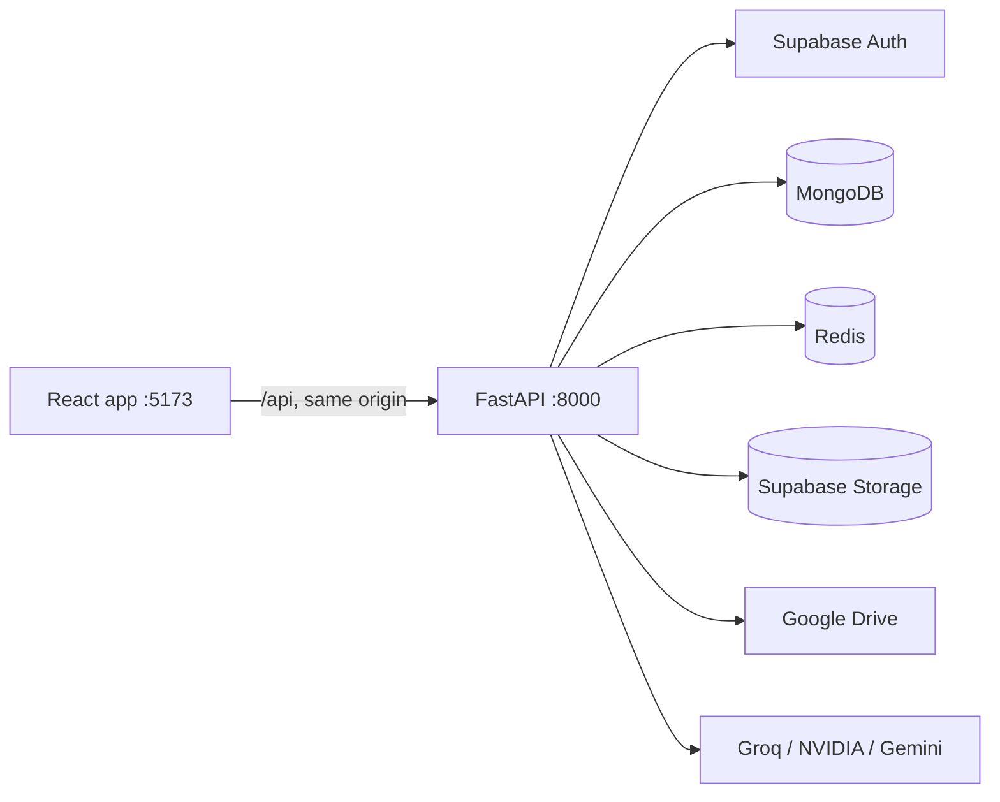

# AI Treasurer

A treasurer's workspace for clubs and societies. It tracks team budgets, receipts (from Google Drive or uploaded by hand), cash in and reimbursements, and has an AI agent that can read your data, scan receipts and build Excel reports. Amounts are in Malaysian Ringgit (RM).

> **Status: in development.** Accounts have no email verification or two-factor sign-in yet, so anyone can register with any email address. Keep it off the public internet until those exist (see [Known limits](#known-limits)).

## Features

- **Accounts**: sign up with a username, email and password; sign in with your username or email, or with Google. Tick **Remember me** to stay signed in after closing the browser (up to 60 days). Everything you see belongs to your account.
- **Overview**: total budget, spent and remaining across teams, cash balance, what needs attention (receipts with no amount, duplicates to review, receipts not reimbursed), per-team budget bars, recent receipts and cash flow, and rule-based notes such as "Games is over budget by RM348.91".
- **Organizations and teams**: each organization has teams, each with a budget, members and an optional Google Drive folder.
- **Receipts management**:
  - Sync a team's Google Drive folder (metadata only; files stay on Drive), or upload images, PDFs or Excel files (stored in Supabase).
  - Edit amount, label and notes; zoomable previews (PDFs render page 1).
  - Filter by source, reimbursement state and duplicates; sort by date or amount.
  - "Set missing amounts" walks through receipts with no amount; "Fill all with AI" does it in the background with cancel and a review list.
  - Duplicate detection by file hash (MD5) across the organization: a duplicate local upload is blocked, Drive duplicates are flagged for a person to confirm or dismiss. Confirmed duplicates are left out of totals.
- **Cash flow**: cash in records (with optional proof image) and reimbursement records linked to receipts. Balance = total cash in − total reimbursement. A reimbursed receipt's amount is locked.
- **Snapshots**: save a point-in-time copy of an organization and browse the whole app read-only from it.
- **AI agent**: persisted multi-conversation chat with read-only access to your teams, budgets and receipts, file attachments, long-term memory (vector search) and Excel export. Runs keep going if you leave the page.
- **AI scan history**: every receipt scan and bulk AI run for the last 14 days, with what the AI answered and what it saved.

## Tech stack

| Part | Uses |
|---|---|
| Frontend | React 19, Vite, Tailwind CSS v4, axios, pdf.js (bun) |
| Backend | Python 3.13, FastAPI, pymongo, redis, openpyxl, pypdfium2, LangChain (uv) |
| Data | MongoDB (main DB plus `ai` and `history`), Redis (cache and pub/sub), Supabase Storage (files) |
| AI | Groq (primary), NVIDIA NIM (fallback and vision), Google Gemini (embeddings) |
| Integrations | Google Drive API (read-only) |



## Getting started

### Prerequisites

- [bun](https://bun.sh) and [uv](https://docs.astral.sh/uv/)
- MongoDB (local or Atlas), a Supabase project, and optionally Redis (the app runs without it)
- Optional: Google Cloud OAuth client for Drive, Groq / NVIDIA / Gemini API keys

### 1. Install

```bash
bun install
cd frontend && bun install
cd ../backend && uv sync
```

### 2. Configure

Create `backend/.env` (never commit it):

| Variable | Purpose |
|---|---|
| `MONGODB_URI` | MongoDB connection string (include credentials in it) |
| `MONGODB_DATABASE_NAME` | Main database name (required) |
| `REDIS_URL` | Optional. Defaults to `redis://redis:6379/0` (the Docker service). For local dev set `redis://localhost:6379/0`. If Redis is unreachable the app still starts (see Known limits) |
| `SUPABASE_URL`, `SUPABASE_PUBLISHABLE_KEY`, `SUPABASE_SECRET_KEY`, `SUPABASE_DATABASE_PASSWORD` | Supabase; the secret (service-role) key is used server-side for storage |
| `FRONTEND_URL` | The address people open the app at (default `http://localhost:5173`; Docker `http://localhost:8080`; your `https://` domain when deployed). Sign-in redirects and the cross-site request check use it |
| `COOKIE_SECURE` | `true` when the app is served over HTTPS (deployed). Default `false` for local http |
| `ALLOWED_ORIGINS` | Optional, comma-separated extra origins allowed to make requests |
| `CLAIM_LEGACY_USER` | Default `true`: the first account to sign in takes over the data made before accounts existed. Set `false` on a fresh deployment |
| `TOKEN_ENCRYPTION_KEY` | Needed for Google Drive. Fernet key that encrypts stored Google tokens (see One-time setup) |
| `GOOGLE_OAUTH_REDIRECT_URI` | Optional (Google Drive connect). Default `http://localhost:8000/api/connect/google/callback`; change when deploying |
| `GROQ_API_KEY`, `GROQ_MODEL` | Primary LLM |
| `NVIDIA_NIM_API_KEY`, `NVIDIA_NIM_MODEL` | Fallback and vision LLM |
| `GEMINI_API_KEY`, `GEMINI_EMBEDDINGS_MODEL` | Embeddings for agent memory |
| `MISTRAL_API_KEY`, `MISTRAL_LLM_MODEL` | Optional |

The frontend needs no env file: it calls `/api` on its own address, and the Vite dev server (or nginx in Docker) forwards that to the backend. Set `BACKEND_URL` when starting Vite if the backend is not on `http://localhost:8000`. `VITE_API_URL` overrides the API address at build time, but sign-in cookies only work when the app and the API share one address.

### 3. One-time external setup

- **Supabase Auth**: the project needs asymmetric JWT signing keys (the default for new projects; Settings > JWT Keys). For "Continue with Google": in Google Cloud create a Web OAuth client with the redirect URI `https://<project>.supabase.co/auth/v1/callback`; in Supabase enable the Google provider with that client and add `<FRONTEND_URL>/api/auth/google/callback` (for each address you use, e.g. `http://localhost:5173`, `http://localhost:8080`) to Authentication > URL Configuration > Redirect URLs. Email sign-up works without any of this.
- **Supabase Storage**: create three **private** buckets: `receipts`, `cashInImage`, `agentExports`. The code never creates them; uploads fail with 502 until they exist.
- **Google Drive** (optional): create a **Web application** OAuth client in Google Cloud, register the redirect URI `http://localhost:8000/api/connect/google/callback` (plus `http://localhost:8080/...` for Docker, and your domain's when deployed), and save its JSON as `backend/google_creds/credentials.json` (gitignored). Set `TOKEN_ENCRYPTION_KEY` (generate with `python -c "from cryptography.fernet import Fernet; print(Fernet.generate_key().decode())"`; keep it safe, losing it means everyone reconnects). Then each user connects their own Drive from Settings; tokens are stored encrypted in MongoDB. A team's receipts sync with its organization owner's Drive. If the Google consent screen is in Testing mode, add yourself as a test user (tokens then expire after 7 days).
- **MongoDB**: indexes are created on backend start. For agent memory recall on Atlas, create the vector index `long-term-memory` on `ai.memories` (`textEmbedding`, 3072 dims, cosine; filter fields `userId`, `orgId`). A replica set (Atlas always is one) gives true all-or-nothing team deletes and snapshots; a standalone server uses a slower fallback.
- **Groq**: accept the chosen model's terms in the Groq console, or calls fail and everything runs on NVIDIA.

### 4. Run (development)

```bash
bun run backend    # FastAPI on http://localhost:8000 (from repo root)
bun run frontend   # Vite on http://localhost:5173
```

The LLM and the embeddings client may be switched off in `backend/lifespan.py` for local work (they are off in the repo right now). AI features then answer 503 or fail the run, and agent memory recall returns nothing.

### Docker

```bash
docker-compose up --build
```

Serves the app through nginx on `http://localhost:8080`; nginx forwards `/api/` to the backend, which is only reachable from the machine itself (`127.0.0.1:8000`). Needs `backend/.env.docker`. Override `FRONTEND_URL`, `COOKIE_SECURE` and `CLAIM_LEGACY_USER` from the shell or a root `.env` file. On a server (e.g. EC2): put HTTPS in front of port 8080 (or terminate it in nginx), then run with `FRONTEND_URL=https://<your domain> COOKIE_SECURE=true`.

## Checks

```bash
cd frontend && bun run lint && bun run build
cd backend && uv run python -c "import main"
cd backend && uv run python tests/test_auth.py   # sign-in, sessions and ownership (fake Supabase, throwaway local MongoDB database)
```

Some backend modules carry their own assert self-checks, e.g. `PYTHONPATH=. uv run python routers/dashboard.py`.

## Project layout

```
backend/
  main.py, lifespan.py      app, startup (DB indexes, clients)
  routers/                  one file per API area (teams, google_drive, cashin, reimbursement, snapshots, agent, dashboard, ...)
  models/                   Pydantic request/response models
  services/                 mongodb, redis, supabase, google, duplicates, auth, ai (inference, tools, skills, embeddings)
  tests/                    self-checks (test_auth.py)
frontend/src/
  pages/                    one file per page
  components/               shared UI (Modal, Toast, ZoomableImage, ReceiptEditor, ...)
  api/                      axios client and one module per API area
  context/, hooks/          app-wide state (sync status, agent runs, snapshot mode, bulk AI fill)
```

## Known limits

- **No email verification, password reset or two-factor sign-in yet** (no mail server). Anyone can register with an email address that is not theirs; usernames and emails cannot be changed after sign-up.
- Failed sign-ins are limited to 5 per 15 minutes per address and username, counted in the backend's memory (reset on restart, separate per worker).
- **Third-party data**: receipt scans, chat messages and attachments are sent to Groq, NVIDIA and Google Gemini.
- Snapshots copy data, not files: receipt and proof images come from the current files.
- Totals are not split by period: a team budget has no month.
- Drive duplicate detection needs Drive's MD5 checksum, so Google-native files (Docs, Sheets) are never checked.
- The Overview reads the whole organization on each visit (no server cache).
- **Redis is optional.** Without it the cache and the AI agent's live status use the backend's own memory: the cache is lost on restart, thumbnails are capped at 64 MB, and it only works with a single backend worker. The app reconnects to Redis by itself (checked about every 30 seconds).

## Notes for contributors

Detailed design notes, decisions and the change log live in `AGENTS.md` (local only, gitignored). Keep this README in step with every user-visible change.
