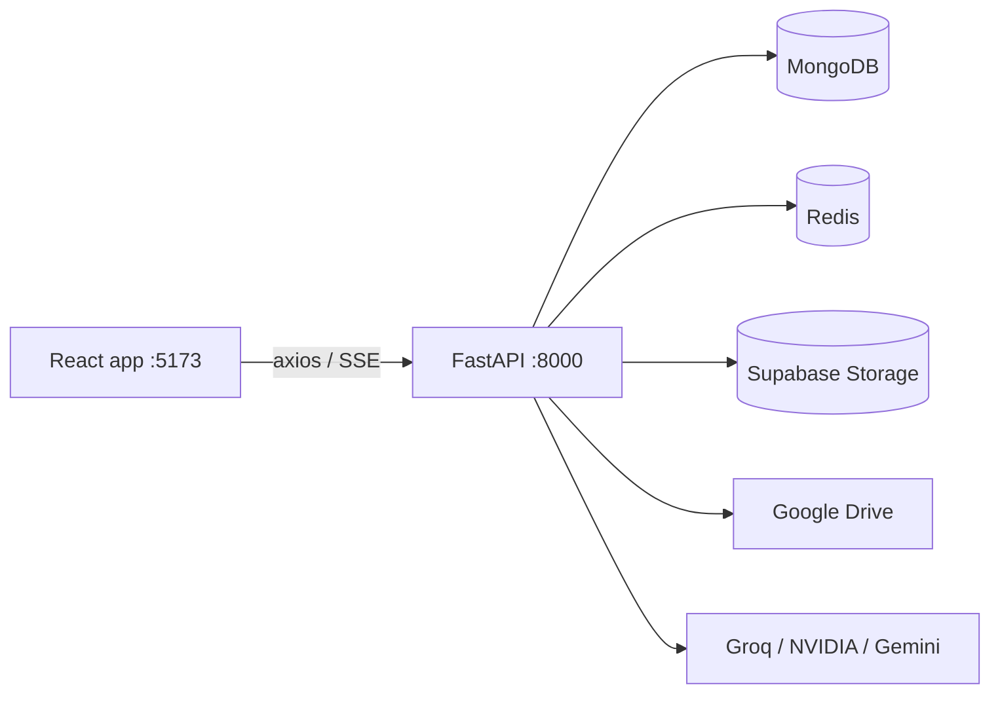

# AI Treasurer

A treasurer's workspace for clubs and societies. It tracks team budgets, receipts (from Google Drive or uploaded by hand), cash in and reimbursements, and has an AI agent that can read your data, scan receipts and build Excel reports. Amounts are in Malaysian Ringgit (RM).

> **Status: in development, single user, no login yet.** Every request uses a placeholder user id, and several routes have no owner check. Do not expose it to the internet as is (see [Known limits](#known-limits)).

## Features

- **Overview**: total budget, spent and remaining across teams, cash balance, what needs attention (receipts with no amount, duplicates to review, receipts not reimbursed), per-team budget bars, recent receipts and cash flow, and rule-based notes such as "Games is over budget by RM348.91".
- **Organizations and teams**: each organization has teams, each with a budget, members and an optional Google Drive folder.
- **Receipts management**:
  - Sync a team's Google Drive folder (metadata only; files stay on Drive), or upload images, PDFs or Excel files (stored in Supabase).
  - Edit amount, label and notes; zoomable previews (PDFs render page 1).
  - Filter by source, reimbursement state and duplicates; sort by date or amount.
  - "Set missing amounts" walks through receipts with no amount; "Fill all with AI" does it in the background with cancel and a review list.
  - Duplicate detection by file hash (MD5) across the organization: a duplicate local upload is blocked, Drive duplicates are flagged for a person to confirm or dismiss. Confirmed duplicates are left out of totals.
- **Cash flow**: cash in records (with optional proof image) and reimbursement records linked to receipts. Balance = total cash in − total reimbursement. A reimbursed receipt's amount is locked.
- **Snapshots**: save a point-in-time copy of an organization and browse the whole app read-only from it.
- **AI agent**: persisted multi-conversation chat with read-only access to your teams, budgets and receipts, file attachments, long-term memory (vector search) and Excel export. Runs keep going if you leave the page.
- **AI scan history**: every receipt scan and bulk AI run for the last 14 days, with what the AI answered and what it saved.

## Tech stack

| Part | Uses |
|---|---|
| Frontend | React 19, Vite, Tailwind CSS v4, axios, pdf.js (bun) |
| Backend | Python 3.13, FastAPI, pymongo, redis, openpyxl, pypdfium2, LangChain (uv) |
| Data | MongoDB (main DB plus `ai` and `history`), Redis (cache and pub/sub), Supabase Storage (files) |
| AI | Groq (primary), NVIDIA NIM (fallback and vision), Google Gemini (embeddings) |
| Integrations | Google Drive API (read-only) |



## Getting started

### Prerequisites

- [bun](https://bun.sh) and [uv](https://docs.astral.sh/uv/)
- MongoDB (local or Atlas), Redis, a Supabase project
- Optional: Google Cloud OAuth client for Drive, Groq / NVIDIA / Gemini API keys

### 1. Install

```bash
bun install
cd frontend && bun install
cd ../backend && uv sync
```

### 2. Configure

Create `backend/.env` (never commit it):

| Variable | Purpose |
|---|---|
| `MONGODB_URI`, `MONGODB_USERNAME`, `MONGODB_PASSWORD` | MongoDB connection |
| `MONGODB_DATABASE_NAME` | Main database name (required) |
| `REDIS_URL` | Default `redis://localhost:6379/0` |
| `SUPABASE_URL`, `SUPABASE_PUBLISHABLE_KEY`, `SUPABASE_SECRET_KEY`, `SUPABASE_DATABASE_PASSWORD` | Supabase; the secret (service-role) key is used server-side for storage |
| `GROQ_API_KEY`, `GROQ_MODEL` | Primary LLM |
| `NVIDIA_NIM_API_KEY`, `NVIDIA_NIM_MODEL` | Fallback and vision LLM |
| `GEMINI_API_KEY`, `GEMINI_EMBEDDINGS_MODEL` | Embeddings for agent memory |
| `MISTRAL_API_KEY`, `MISTRAL_LLM_MODEL` | Optional |

Create `frontend/.env`:

| Variable | Purpose |
|---|---|
| `VITE_API_URL` | Backend URL; defaults to `http://localhost:8000`. Use `/api` for the Docker/nginx build |
| `VITE_TEMP_USER_ID` | Placeholder owner id until login exists |

### 3. One-time external setup

- **Supabase Storage**: create three **private** buckets: `receipts`, `cashInImage`, `agentExports`. The code never creates them; uploads fail with 502 until they exist.
- **Google Drive** (optional): put the OAuth client file at `backend/google_creds/credentials.json`, then connect from Settings. The token is saved as `backend/google_creds/token.json`. Both are gitignored.
- **MongoDB**: indexes are created on backend start. For agent memory recall on Atlas, create the vector index `long-term-memory` on `ai.memories` (`textEmbedding`, 3072 dims, cosine; filter fields `userId`, `orgId`). A replica set (Atlas always is one) gives true all-or-nothing team deletes and snapshots; a standalone server uses a slower fallback.
- **Groq**: accept the chosen model's terms in the Groq console, or calls fail and everything runs on NVIDIA.

### 4. Run (development)

```bash
bun run backend    # FastAPI on http://localhost:8000 (from repo root)
bun run frontend   # Vite on http://localhost:5173
```

LLM init may be switched off in `backend/lifespan.py` for local work; AI features then answer 503 or fail the run.

### Docker

```bash
docker-compose up --build
```

Serves the built frontend through nginx on `http://localhost:8080` (proxying `/api/` to the backend) plus the backend on 8000 and Redis. Needs `backend/.env.docker` and `frontend/.env`.

## Checks

```bash
cd frontend && bun run lint && bun run build
cd backend && uv run python -c "import main"
```

Some backend modules carry their own assert self-checks, e.g. `PYTHONPATH=. uv run python routers/dashboard.py`.

## Project layout

```
backend/
  main.py, lifespan.py      app, startup (DB indexes, clients)
  routers/                  one file per API area (teams, google_drive, cashin, reimbursement, snapshots, agent, dashboard, ...)
  models/                   Pydantic request/response models
  services/                 mongodb, redis, supabase, google, duplicates, ai (inference, tools, skills, embeddings)
frontend/src/
  pages/                    one file per page
  components/               shared UI (Modal, Toast, ZoomableImage, ReceiptEditor, ...)
  api/                      axios client and one module per API area
  context/, hooks/          app-wide state (sync status, agent runs, snapshot mode, bulk AI fill)
```

## Known limits

- **No authentication.** Identity is a placeholder id; `/api/google-drive/*` and `/api/agent/*` have no owner check. Add auth before any public deployment.
- **Third-party data**: receipt scans, chat messages and attachments are sent to Groq, NVIDIA and Google Gemini.
- Snapshots copy data, not files: receipt and proof images come from the current files.
- Totals are not split by period: a team budget has no month.
- Drive duplicate detection needs Drive's MD5 checksum, so Google-native files (Docs, Sheets) are never checked.
- The Overview reads the whole organization on each visit (no server cache).

## Notes for contributors

Detailed design notes, decisions and the change log live in `AGENTS.md` (local only, gitignored). Keep this README in step with every user-visible change.
